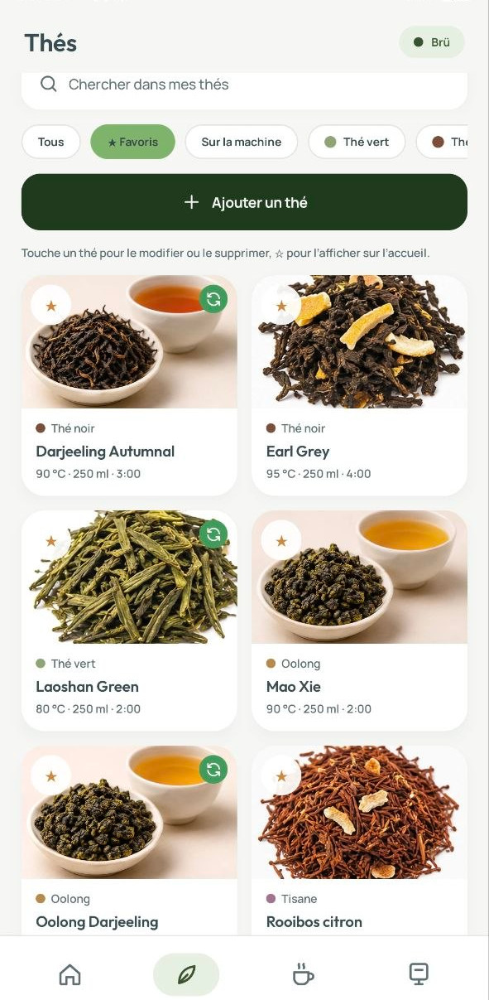
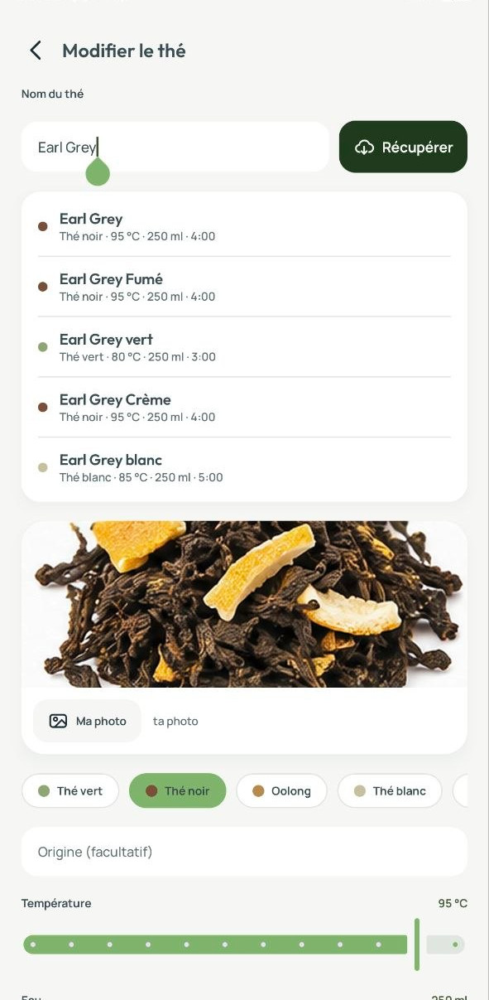
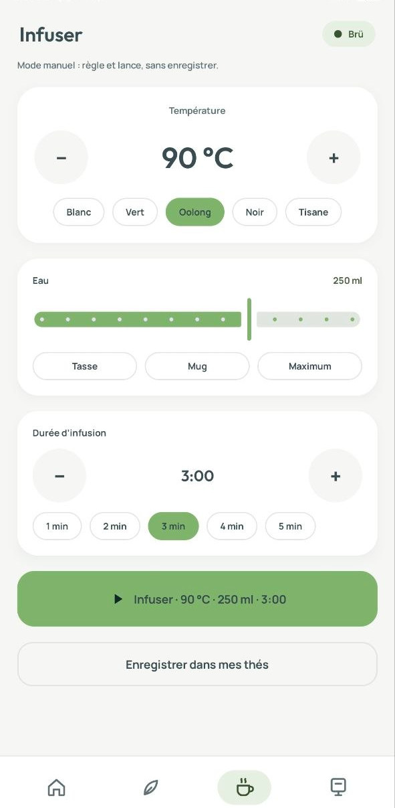
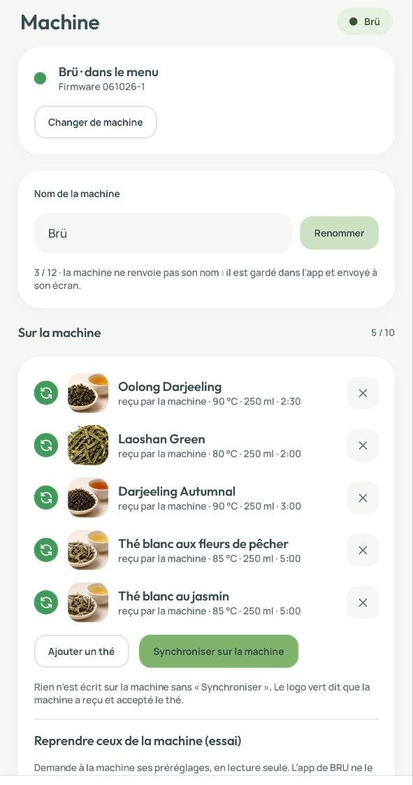
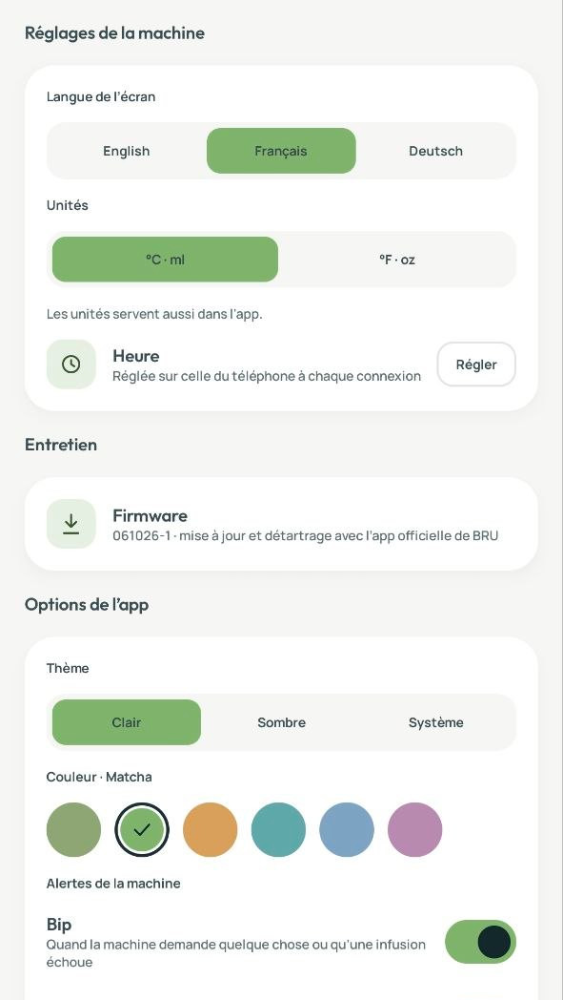

# Infusion

*[Version française](README.md)*

**Infusion** is an **unofficial** Android app to control the **BRU Maker One** tea machine over Bluetooth.
It is not written, supported or endorsed by BRU; “BRU” and “Maker One” belong to their owners.

## What it does

- Home: the machine (status, blinking machine requests, “Brew again”, manual mode) and your favourites.
- Teas: your own list (photo, settings, notes), with suggestions and sheets taken from a public tea
  database (repository [TheWorms/tea-db](https://github.com/TheWorms/tea-db), see `docs/base-thes.md`).
- Brewing from the phone, followed on screen and in a notification, even with the app closed.
- Machine: up to 10 teas synced to the machine (only on request), machine name, language
  (French, English) and units, clock.
- No machine firmware updates: those remain with the official app.

The machine's Bluetooth protocol is implemented in `app/src/main/java/fr/theworms/infusion/ble/`.

## Screenshots

| Teas | Edit a tea | Brew |
|:---:|:---:|:---:|
|  |  |  |

| Machine | Settings |
|:---:|:---:|
|  |  |

## Build

Android SDK (compileSdk 35) and JDK 17 to 21:

```bash
./gradlew assembleDebug          # debug APK
./gradlew testDebugUnitTest      # JVM tests (Robolectric)
```

After the tests, `app/build/captures/` holds screenshots of the main screens in French and English.

A signed build (`assembleRelease`) reads its key from a properties file outside the repository
(`infusion.releaseSigning`); without it, the release APK is unsigned.

## Data

Everything stays on the phone (Room database, DataStore settings, photos in the app's private files).
The app only goes online to read the public tea database and its own update channel.

## Licence

MIT — see [LICENSE](LICENSE).
