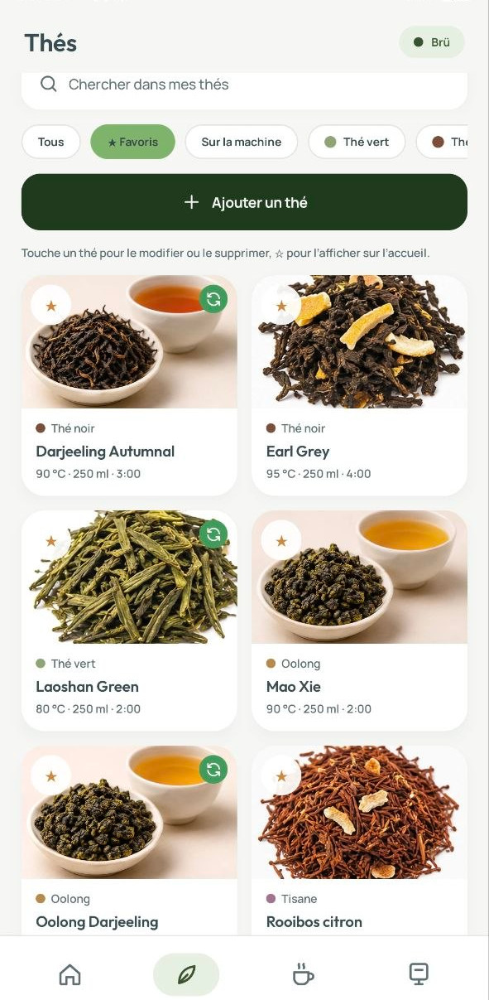
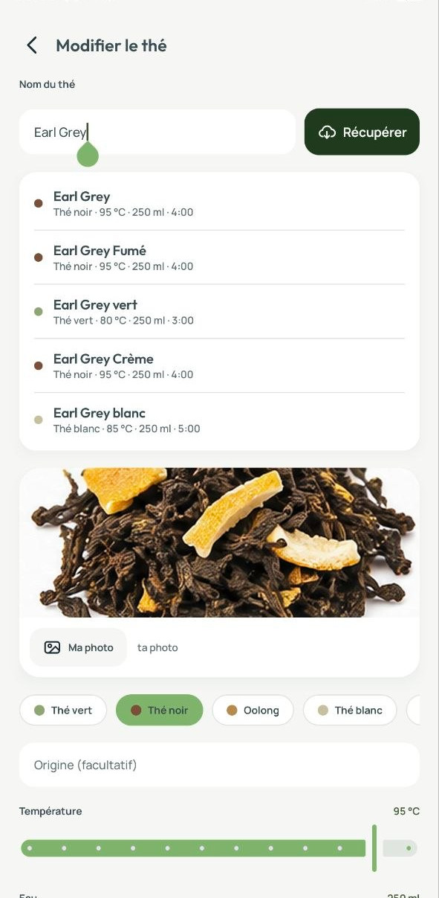
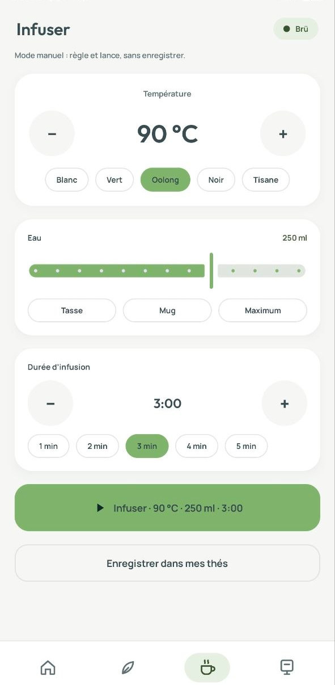
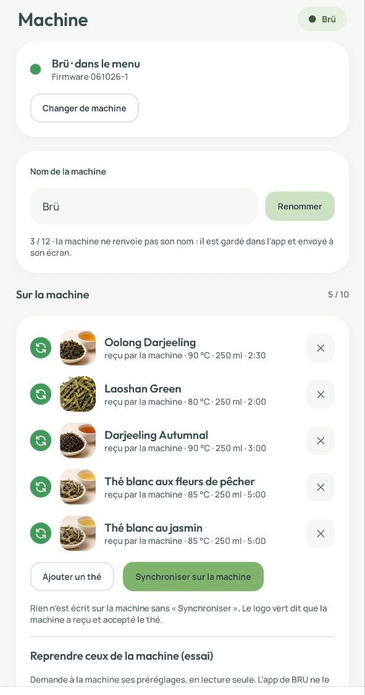
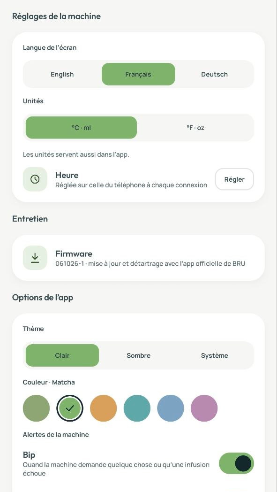

# Infusion

*[English version](README.en.md)*

**Infusion** est une app Android **non officielle** pour piloter en Bluetooth la machine à thé
**BRU Maker One**. Elle n'est ni écrite, ni soutenue, ni approuvée par BRU ; « BRU » et « Maker One »
appartiennent à leurs propriétaires.

## Ce qu'elle fait

- Accueil : la machine (état, demandes de la machine en clignotant, « Refaire », mode manuel), les favoris.
- Thés : sa propre liste (photo, réglages, notes), avec suggestions et fiches reprises d'une base publique
  de thés (dépôt [TheWorms/tea-db](https://github.com/TheWorms/tea-db), voir `docs/base-thes.md`).
- Infusion depuis le téléphone, suivie à l'écran et en notification, y compris app fermée.
- Machine : jusqu'à 10 thés synchronisés sur la machine (seulement sur demande), nom de la machine, langue
  (français, anglais) et unités, heure.
- Pas de mise à jour du firmware de la machine : elle reste réservée à l'app officielle.

Le protocole Bluetooth de la machine est implémenté dans `app/src/main/java/fr/theworms/infusion/ble/`.

## Captures

| Thés | Modifier un thé | Infuser |
|:---:|:---:|:---:|
|  |  |  |

| Machine | Réglages |
|:---:|:---:|
|  |  |

## Construire

Android SDK (compileSdk 35) et JDK 17 à 21 :

```bash
./gradlew assembleDebug          # APK de débogage
./gradlew testDebugUnitTest      # tests JVM (Robolectric)
```

`app/build/captures/` reçoit, après les tests, des captures des écrans principaux en français et en anglais.

Une construction signée (`assembleRelease`) lit sa clé dans un fichier de propriétés hors du dépôt
(`infusion.releaseSigning`) ; sans lui, l'APK de version n'est pas signée.

## Données

Tout reste sur le téléphone (base Room, réglages DataStore, photos dans les fichiers privés de l'app).
L'app ne lit en réseau que la base de thés publique et son propre canal de mises à jour.

## Licence

MIT — voir [LICENSE](LICENSE).
